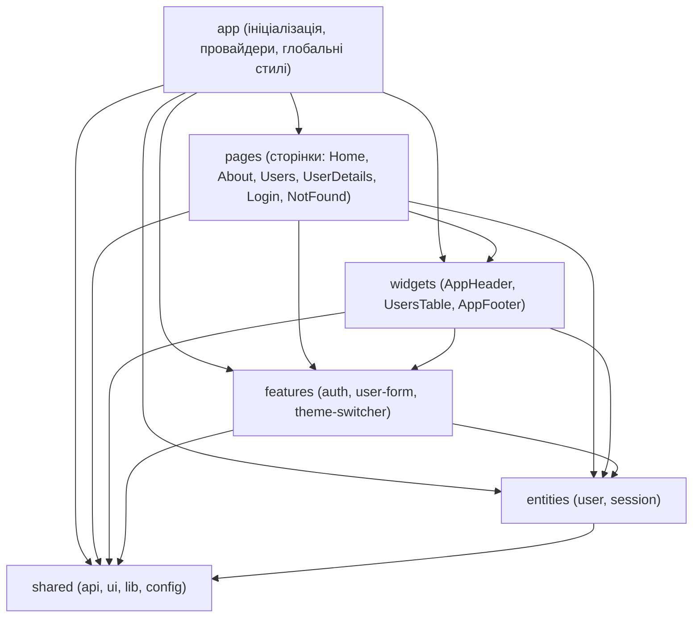

# vue-lottery-app

Сучасний SPA-додаток на **Vue 3 + TypeScript + Composition API + Vue Router 4 + Pinia**, організований за методологією **Feature-Sliced Design (FSD)** та інтегрований із UI-бібліотекою **PrimeVue**. 

Виконано в межах **Лабораторної роботи №6** («Архітектура Feature-Sliced Design (FSD), керування станом за допомогою Pinia та використання UI-бібліотеки компонентів»).

🔗 **Демо на GitHub Pages:** [https://kinelmykhailo.github.io/vue-lottery-app/](https://kinelmykhailo.github.io/vue-lottery-app/)

---

## 🎯 Мета лабораторної роботи
1. Ознайомлення з методологією **Feature-Sliced Design (FSD)** для масштабованої організації фронтенд-застосунку.
2. Централізоване керування станом за допомогою **Pinia** (підхід Setup Stores) та збереження стану через `pinia-plugin-persistedstate`.
3. Інтеграція UI-бібліотеки компонентів (**PrimeVue**) через ізолюючі обгортки у шарі `shared/ui`.
4. Перевірка архітектурних правил імпорту за допомогою лінтерів **Steiger** та **eslint-plugin-boundaries**.
5. Реалізація перемикача темної/світлої теми з персистентністю.

---

## 🏗️ Архітектура Feature-Sliced Design (FSD)

Застосунок розділено на 6 ієрархічних шарів з суворим напрямком залежностей (зверху вниз). Модулі верхніх рівнів можуть імпортувати лише модулі з нижчих рівнів через Public API (`index.ts`). Слайси одного рівня ізольовані один від одного.



### Структура директорій
```
src/
├── app/                      # Ініціалізація додатку, роутер, глобальні провайдери та стилі
│   ├── providers/
│   │   ├── router/           # Конфігурація Vue Router та Navigation Guards
│   │   ├── services.ts       # Реєстрація сервісів у ServiceProvider
│   │   └── ui.ts             # Підключення PrimeVue, ToastService, ConfirmationService
│   ├── styles/               # SCSS-стилі Bootstrap 5 + PrimeVue теми + Dark mode
│   └── App.vue               # Кореневий компонент
├── pages/                    # Сторінки (один слайс = одна сторінка)
│   ├── home/                 # Головна сторінка
│   ├── about/                # Сторінка про автора
│   ├── login/                # Сторінка авторизації
│   ├── users/                # Сторінка списку користувачів
│   ├── user-details/         # Профіль користувача та форма редагування
│   └── not-found/            # 404 сторінка
├── widgets/                  # Самодостатні великі блоки інтерфейсу
│   ├── app-header/           # Шапка сайту з Logo, навігацією та ThemeSwitcher
│   ├── app-footer/           # Підвал сайту
│   └── users-table/          # Таблиця користувачів з підтвердженням видалення
├── features/                 # Бізнес-фічі користувача
│   ├── auth/                 # LoginForm, LogoutButton
│   ├── user-form/            # UserCreateModal, UserEditForm (VeeValidate + Yup)
│   └── theme-switcher/       # Перемикач світлої/темної теми (ThemeSwitcher + store)
├── entities/                 # Бізнес-сутності
│   ├── user/                 # types, UserService, users.store (Pinia setup store)
│   └── session/              # types, AuthService, session.store (Pinia setup store)
├── shared/                   # Перевикористовуваний загальний код
│   ├── api/                  # http-client, інтерфейси Repository, ServiceProvider
│   ├── ui/                   # Обгортки: AppButton, AppInput, AppTable, AppConfirmDialog, AppToast, Modal, Logo
│   ├── lib/                  # Утиліти валідації
│   └── config/               # Змінні оточення (API_URL)
└── main.ts                   # Точка входу в застосунок
```

---

## 📦 Розподіл Repository у FSD

| Складова | Розташування у FSD | Призначення |
|---|---|---|
| `http-client`, інтерфейси `Readable`, `Creatable`, `Editable`, `Deletable` | `src/shared/api` | Базовий транспорт та контракти |
| `ServiceProvider` (універсальний реєстр фабрик) | `src/shared/api/service-provider.ts` | Реєстр без імпортів з `entities` |
| `User`, `CreateUserDto`, `UpdateUserDto` | `src/entities/user/model/types.ts` | Модель сутності користувача |
| `UserService` | `src/entities/user/api/user.service.ts` | Реалізація репозиторію користувачів |
| `AuthService`, `AuthUser` | `src/entities/session/` | Репозиторій та модель сесії |
| Реєстрація сервісів | `src/app/providers/services.ts` | Підключення конкретних сервісів на рівні `app` |

---

## 💾 Керування станом (Pinia) та порівняння збереження стану

У проєкті використано підхід **Setup Stores** (`defineStore('id', () => { ... })`).

### Порівняння: Ручна реалізація vs `pinia-plugin-persistedstate`

| Критерій | Ручна реалізація (`session.store.ts`) | Плагін `pinia-plugin-persistedstate` |
|---|---|---|
| **Код та декларативність** | Вимагає ручних викликів `localStorage.getItem` та `localStorage.setItem` у кожній дії | Декларативна конфігурація: `persist: { paths: [...] }` |
| **Синхронізація** | Необхідно вручну стежити за очищенням та оновленням кожного окремого ключа | Автоматична серіалізація/десеріалізація при будь-якій зміні стейту |
| **Безпека типів та помилки парсингу** | Потрібно огортати `JSON.parse` у `try/catch` для запобігання падінню додатку | Вбудована безпечна обробка помилок |
| **Гнучкість сховища** | Прив'язано до конкретного `localStorage` | Легко перемикається між `localStorage`, `sessionStorage` чи кастомним сховищем |

---

## 🎨 UI-бібліотека PrimeVue та обгортки у `shared/ui`

Для виключення жорсткої прив'язки коду додатку до бібліотеки, компоненти PrimeVue обгорнуто у власні компоненти в `shared/ui`:
- **`AppButton`** — обгортка над PrimeVue `Button` (підтримка `loading`, `severity`, `outlined`, `size`).
- **`AppInput`** — обгортка над PrimeVue `InputText` з вбудованим відображенням тексту помилки валідації (`p-error`).
- **`AppTable`** — обгортка над PrimeVue `DataTable`.
- **`AppConfirmDialog`** — обгортка над PrimeVue `ConfirmDialog` для підтвердження видалення користувачів через `useConfirm()`.
- **`AppToast`** — спливаючі сповіщення (Toast) про результати операцій (створення, оновлення, видалення користувача, вхід).

Жоден компонент PrimeVue не імпортується напряму в сторінках чи віджетах — тільки через `shared/ui`.

---

## 🚀 Встановлення та запуск

```bash
# Клонування репозиторію
git clone https://github.com/kinelmykhailo/vue-lottery-app.git
cd vue-lottery-app

# Перехід у гілку лабораторної роботи №6
git checkout feature/fsd

# Встановлення залежностей
npm install

# Перевірка FSD-архітектури лінтером Steiger
npm run lint:fsd

# Перевірка ESLint (включаючи eslint-plugin-boundaries)
npm run lint

# Перевірка типів TypeScript
npm run type-check

# Запуск dev-сервера
npm run dev

# Продакшн-збірка
npm run build
```

---

## 🔑 Тестові дані для входу
- **Username:** `emilys`
- **Password:** `emilyspass`
*(Доступна кнопка швидкої автопідстановки тестових даних у формі входу).*

---

## 👤 Автор
- **Студент:** Кінель Михайло (Misha Kinel)
- **GitHub:** [@kinelmykhailo](https://github.com/kinelmykhailo)
- **Репозиторій:** [vue-lottery-app](https://github.com/kinelmykhailo/vue-lottery-app)
